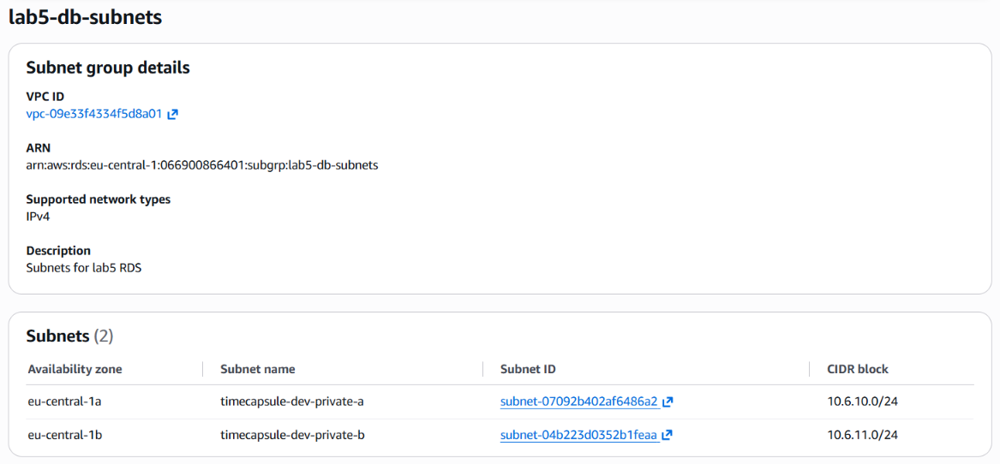
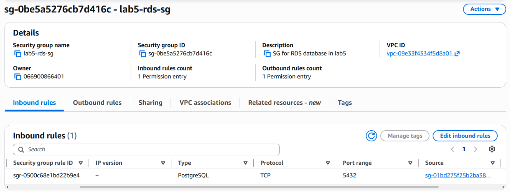

# Отчёт по лабораторной работе №5. Облачные базы данных. Amazon RDS

**ФИО:** Дарья Бурцева  
**Группа:** IA2403  
**Специальность:** Informatică Aplicată  
**Уровень:** Продвинутый  
**Ссылка на репозиторий:** https://github.com/burtevadaria-cloud/lab5

## 1. Базовый уровень

### Задания 1-3
**Группа подсетей:**

**Как ограничен доступ к базе (Security Group):**

**Узнайте IP-адрес базы:**

**\conninfo, SELECT * FROM notes, проверки доступа:**

### Задания 4-5
**Ошибка INSERT на реплике:**  

**Проверка pg_is_in_recovery() на основной базе:**  
,%20основная%20база,%20задание%204.png)

**Строка fourth на реплике:**  

**Отставание реплики (ReplicaLag):**  

**Удаление данных и запоминание времени:**  

**Пустая таблица на реплике:**  

**Форма восстановления (Point-in-Time Recovery):**

**Строки после возврата из резервной копии:**

## 2. Продвинутый уровень

### Задания 6-7
**Вкладка Connectivity & security базы приложения:**

**Расписание EventBridge Scheduler:**

**Событие остановки (база остановлена расписанием):**

### Задания 8-10
**Количество пользователей и капсул в обеих базах:**

**Проверка DNS-записи (dig db.timecapsule.internal):**

**Новая капсула в приложении и запись в RDS:**

**Удаленный db-server:**

### Задание 11
**/health во время перезагрузки:**

**События StopDBInstance (Logs & events):**

## 3. Архитектура
**Схема:**

**Архитектурное решение:** 
[docs/adr/0004-database-hosting.md](docs/adr/0004-database-hosting.md)

## 4. Ответы на контрольные вопросы

**Почему для ограничения доступа удобнее использовать Security Group источника, а не его IP-адрес? Зачем указывать две подсети, если учебная база будет работать в одной зоне?**  
Использование Security Group надежнее, так как IP-адрес EC2-инстанса может измениться при перезагрузке, а привязка по SG работает всегда. Две подсети в разных зонах требуются политикой AWS RDS для обеспечения отказоустойчивости (Subnet Group), даже если развертывается Single-AZ база.

**Как убедиться, что база принимает подключения только с нужного сервера? Почему для неё выбрана зона eu-central-1a? От чего защищает deletion protection, а от чего нет?**  
Можно попытаться подключиться к RDS с бастиона или локального ПК - подключение зависнет по таймауту. Зона `eu-central-1a` выбрана для минимизации задержек и стоимости трафика, так как там же находится app-server. Deletion protection защищает базу от случайного удаления инстанса в консоли AWS, но не защищает от удаления данных (DROP TABLE, DELETE) внутри самой СУБД.

**Почему INSERT на реплике не выполнился? Чем реплика для чтения отличается от резервного экземпляра Multi-AZ?**  
Реплика для чтения доступна только для SELECT-запросов. В отличие от Multi-AZ, который скрыт от пользователя, синхронен и используется только для автоматического переключения при аварии (failover), реплика для чтения асинхронна и имеет собственный эндпоинт для разгрузки основной БД от "тяжелых" чтений.

**Почему реплика не спасла данные? Почему восстановление создаёт новую базу, а не откатывает старую?**  
Команда `DELETE` была мгновенно реплицирована на реплику для чтения. Восстановление (PITR) всегда создает новый инстанс, чтобы не перезаписать и не уничтожить текущую базу, которая может использоваться для анализа инцидента или извлечения последних логов.

**Какие параметры базы приложения вы выбрали бы иначе для рабочей системы с реальными пользователями? Почему?**  
Для production-среды я бы выбрала развертывание Multi-AZ для высокой доступности, инстанс большего размера (например, m6g) для стабильной производительности, включила Storage Autoscaling и увеличила срок хранения бэкапов минимум до 14-30 дней.

**Зачем расписанию своя роль, если вы и сами можете остановить базу? Почему роль может остановить только одну базу?**  
EventBridge Scheduler - это отдельный сервис AWS. Чтобы он мог выполнять действия от нашего имени в фоне, ему нужно делегировать права (AssumeRole). В политике указан конкретный ARN (`timecapsule-dev-rds`), чтобы соблюсти принцип наименьших привилегий — если расписание будет взломано или сломано, оно не остановит другие важные базы.

**Почему приложению нужен отдельный пользователь, а не dbadmin?**  
Это базовое правило безопасности. Если злоумышленник найдет уязвимость в приложении и получит доступ к БД, его права будут ограничены только таблицами приложения `timecapsule`, и он не сможет удалить саму базу, создать новых суперпользователей или прочитать системные данные.

**Почему не пришлось менять DB_HOST? Какие обязанности из ЛР3 перешли к AWS, а какие остались за вами?**  
Переменная `DB_HOST` использовала DNS-имя (`db.timecapsule.internal`), поэтому нам было достаточно изменить CNAME-запись в Route 53, код приложения менять не пришлось. К AWS перешли обязанности по обновлению ОС, патчингу СУБД, созданию бэкапов и поддержанию железа. За нами остались настройки сети (VPC, SG), логика базы (схемы, таблицы, пользователи) и оптимизация запросов.

**Что показывал /health во время перезагрузки? Изменился ли endpoint после остановки и запуска? Какую ошибку получает расписание, если база уже остановлена?**  
Во время перезагрузки `/health` показывал ошибку подключения. Эндпоинт (DNS-адрес, выданный AWS) не изменился, так как он привязан к самому инстансу. Если база уже остановлена, расписание завершается с ошибкой (событие Failure), так как API AWS возвращает ошибку `InvalidDBInstanceState`.
